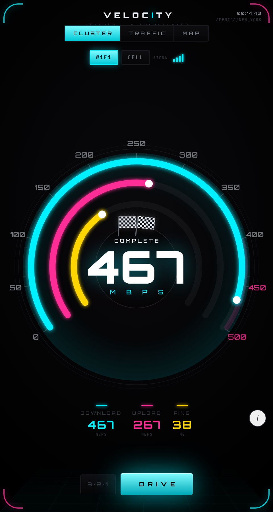
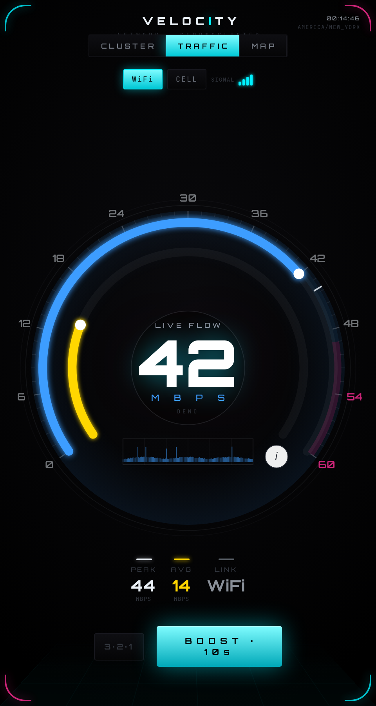
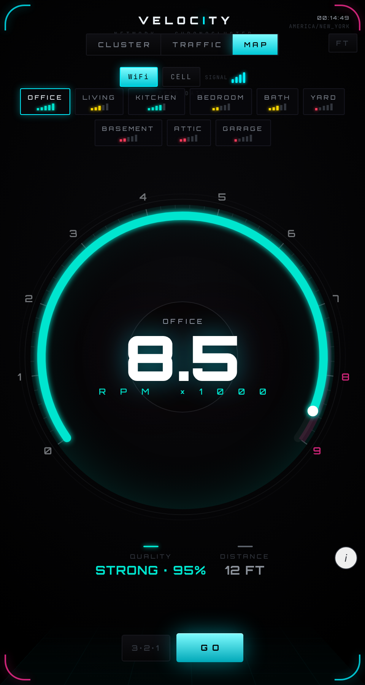

<div align="center">

# ⚡ velocity

### A network speed test, built as one chronograph instrument — in a single HTML file.

$\textcolor{#00E5CF}{\textsf{download}}$ · $\textcolor{#FFD700}{\textsf{upload}}$ · $\textcolor{#FF3D5C}{\textsf{ping}}$

*No accounts, no sign-up, no ads — and your exact location never leaves your device.*

**▶ Open it — [codereimagine.github.io/velocity](https://codereimagine.github.io/velocity/)**

<p>
  
  
  
</p>

<sub>CLUSTER · TRAFFIC · MAP — three faces, one instrument</sub>

<sub>By <b>Bert Peters</b> · <a href="https://github.com/codereimagine">codereimagine</a></sub>

</div>

---

## ⚡ What is it?

velocity measures your internet speed and shows it as a living chronograph. It's a single HTML file — open it and it runs instantly. Three faces: $\textcolor{#00E5CF}{\textsf{Cluster}}$ (download, upload and ping on one dial), $\textcolor{#FFD700}{\textsf{Traffic}}$ (your throughput live over time), and $\textcolor{#FF3D5C}{\textsf{Map}}$ (your connection quality, room by room). One tap to run.

No app store, no account, nothing to sign up for. Open the link and it works. Like it? Add it to your home screen like any other app.

## ✨ How we do things differently

Most apps want your account, your data, and your attention. Every codereimagine app is built $\textcolor{#00E5CF}{\textsf{the other way round}}$:

- **Private by default** — no accounts, no tracking, nothing sold. Your exact location stays on *your* device.
- **No ads, no clutter** — nothing on the screen is trying to sell you something.
- **Yours to keep** — one self-contained HTML file: no install, no dependencies, and it runs from any web server.
- **Fully open & free** — the whole thing is public (Apache-2.0). Nothing hidden.
- **Made to feel good** — an everyday tool should be beautiful, not just functional.

## 👀 What you can do with it

- **Test your speed** — download, upload and ping on one dial, with a stability bar so you know how steady the reading was.
- **Watch it live** — throughput over time, with peak and session average.
- **Map your signal** — test each room's connection quality; run the optional helper for true WiFi signal strength.
- **Anywhere** — fast on phones and computers.

## 🛠️ Run or build it yourself (developers)

It's a single HTML file — no build, no dependencies. Browsers block `file://` fetches, so serve it over http:

```bash
git clone https://github.com/codereimagine/velocity.git
cd velocity
python3 -m http.server 8099
# open http://127.0.0.1:8099/index.html
```

<details><summary><b>🔧 Under the hood</b></summary>

- **One file:** the whole app is a single HTML page — vanilla JavaScript, Canvas 2D + `requestAnimationFrame`, `localStorage`. No framework, no build, no dependencies.
- **Measurement:** download, upload and latency run over [Cloudflare](https://developers.cloudflare.com/speed/)'s keyless HTTPS endpoints, measured on a settled window (TCP slow-start excluded) with a per-run **stability error bar** — every reading carries how steady it was.
- **Locked down:** a strict Content-Security-Policy pins the script by hash and limits network egress to Cloudflare's speed endpoints and the optional local helper only — nothing else can run or phone home. Room readings are saved only in your own browser.
- **What a speed test sees:** like any speed test, measuring your connection shows your IP address to the server it tests against (here, Cloudflare). That's inherent to the measurement — velocity adds no tracking of its own.
- **Optional:** a Python loopback helper (standard library only, on `127.0.0.1:7717`) reads true WiFi signal strength (RSSI in dBm) and flow when run on a laptop.
- **Fonts:** JetBrains Mono + Orbitron, embedded in the file.

</details>

## 🙌 Credits & thanks

Built with [Claude Code](https://claude.com/claude-code). $\textcolor{#FFD700}{\textsf{Nothing here is hidden}}$ — velocity stands on:

- **Speed test** — [Cloudflare](https://developers.cloudflare.com/speed/)'s keyless HTTPS speed endpoints.
- **Fonts** — JetBrains Mono & Orbitron (SIL Open Font License 1.1).
- **Emoji** — standard Unicode, drawn by your device.

## 📄 License

Apache-2.0 — see [LICENSE](LICENSE).
